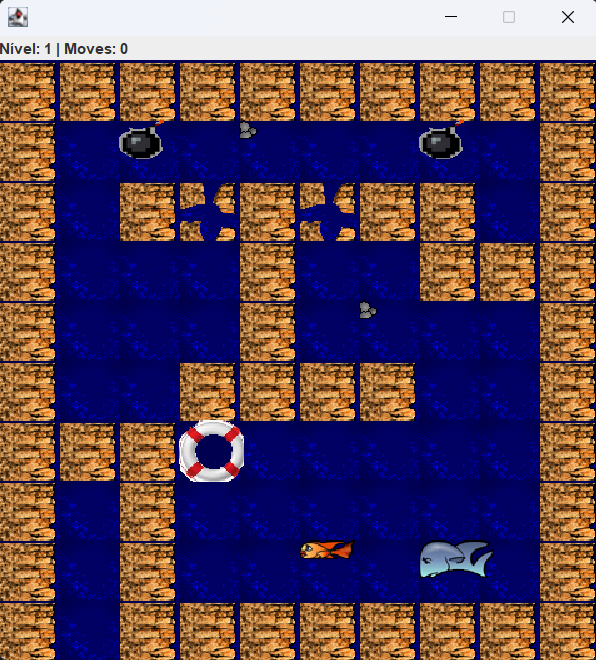

# Fish n Fillets (Java)

Versão simplificada do jogo de puzzle *Fish n Fillets*, desenvolvida em Java no âmbito da cadeira de Programação Orientada a Objetos (Iscte). Controlas dois peixes, um pequeno e um grande, e tens de os levar para fora do tabuleiro empurrando objetos, evitando armadilhas e usando o peso de cada peixe a teu favor.

<!-- Adicionar aqui uma captura de ecrã ou GIF do jogo a funcionar -->

## Como correr

1. Abre o projeto num IDE (Eclipse ou IntelliJ) com o JDK **[JDK 17]**.
2. Corre a classe `pt.iscte.poo.game.Main`.

O jogo lê os níveis (`rooms/`) e as imagens (`images/`) através de caminhos relativos, por isso tem de ser executado a partir da **raiz do projeto**.

## Controlos

| Tecla | Ação |
|---|---|
| Setas | Mover o peixe selecionado |
| Espaço | Trocar de peixe |
| R | Reiniciar o nível |

## Regras

- **Objetivo:** levar os dois peixes para fora do tabuleiro. Quando ambos saem, passas ao nível seguinte (existem 5 níveis).
- **Peixe pequeno:** só empurra objetos leves, e apenas na horizontal. Consegue atravessar paredes com buraco e armadilhas. Morre se tocar num caranguejo.
- **Peixe grande:** empurra objetos pesados e em cadeia na horizontal. Morre se tocar numa armadilha. Elimina caranguejos ao mover-se contra eles.
- **Esmagamento:** o peixe pequeno morre com um objeto pesado em cima, ou com mais do que um leve. O grande morre com mais do que um pesado, ou com um pesado e um leve.
- **Bombas:** explodem depois de caírem e destroem os objetos em redor (menos as paredes indestrutíveis). Também matam o peixe que esteja ao alcance.
- **Pedras:** algumas escondem um caranguejo, que aparece quando a pedra é empurrada.
- **Boias:** flutuam para cima em vez de cair.
- **Troncos:** partem-se quando um objeto pesado cai em cima.
- **Pontuações:** no fim do último nível guarda-se o nome, o tempo e o número de movimentos, e é mostrado o top 10 (ordenado por movimentos, depois por tempo).

## Estrutura do código

- `pt.iscte.poo.game`: `Main`, `GameEngine` (lógica do jogo, gravidade, esmagamento, níveis e pontuações) e `Room` (leitura dos níveis a partir dos ficheiros de texto).
- `objects`: hierarquia de objetos do jogo (`GameObject`, `MovebleObjects`, `ImmovableObjects`, `GameCharacter`, e uma classe por tipo de objeto).
- A gravidade é polimórfica: `MovebleObjects.gravity()` define o comportamento por defeito, e cada classe especializa-o (`canFallInto` ou `gravity()`).
- A regra de esmagamento é definida por cada peixe através de `isCrushedBy`.

## Créditos

- A base do projeto (`ImageGUI`, `ImageTile`, `Point2D`, `Vector2D`, `Direction` e o padrão `Observer`/`Observed`) foi fornecida pelos docentes da cadeira.

## Autor

João Pedro Muacho Almeida
